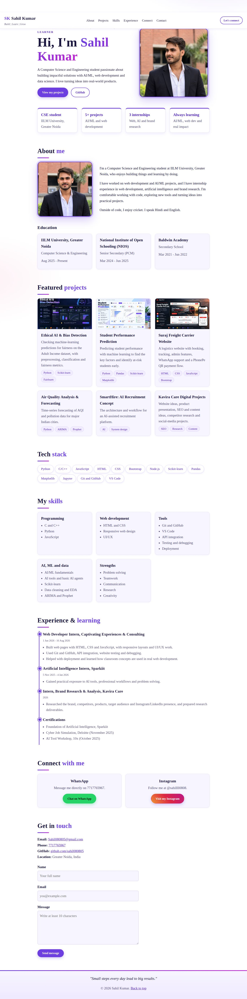

# Personal Portfolio Website

A personal portfolio for **Sahil Kumar**, a Computer Science and Engineering student. Live site: https://sahil080805.github.io

## Project overview
**Goal:** build a multi-section portfolio using semantic HTML5 and CSS, to practise page structure, lists, links, images and forms.

**Sections:** About (with education), Featured Projects, Tech Stack, Skills, Experience and Certifications, Connect (WhatsApp and Instagram), and Contact.

## Setup instructions
1. Install [VS Code](https://code.visualstudio.com/) (optional: the *Live Server* extension).
2. Download or clone this repository:
   ```
   git clone https://github.com/sahil080805/sahil080805.github.io.git
   ```
3. Open the folder in VS Code.
4. Open `index.html` in a browser, or right-click it and choose **Open with Live Server**.
5. No installation or build step is needed (`requirements.txt` only explains this).

## Code structure
```
├── index.html          # all page content, with CSS in a <style> block
├── README.md           # this file
├── requirements.txt    # optional; no packages needed
└── images/
    ├── profile.jpg
    ├── profile-hero.jpg
    ├── project-ethical-ai.jpg
    ├── project-student-prediction.jpg
    ├── project-suraj-freight.jpg
    ├── screenshot-desktop.jpg
    └── screenshot-mobile.jpg
```

## Visual documentation
Desktop view:



Mobile view:


## HTML concepts learned
- **Document structure:** `<!DOCTYPE html>`, `<html lang="en">`, `<head>` (charset, viewport, title, description) and `<body>`.
- **Semantic tags:** `<header>`, `<nav>`, `<main>`, `<section>`, `<article>` and `<footer>` describe what each part is for, which helps screen readers and search engines.
- **Headings and paragraphs:** one `<h1>` for the page, `<h2>` for sections and `<h3>` for cards.
- **Lists:** `<ul>` and `<li>` for skills, tools, certifications, project tags and the tech stack.
- **Internal navigation:** `<a href="#projects">` jumps to the element with `id="projects"`.
- **External links:** `target="_blank"` together with `rel="noopener noreferrer"`, plus `mailto:` and `tel:` links.
- **Images:** ``. The `alt` text describes each picture for people who cannot see it.
- **Forms:** `<label for>` linked to `<input id>`, with validation attributes `required`, `type="email"`, `minlength` and `maxlength`.

## Technical details
The site is static, so there are no algorithms or data structures.
- **Architecture:** one HTML file with a `<header>` and `<nav>` at the top, nine `<section>`s inside one `<main>`, and a `<footer>`. The page needs no JavaScript.
- **CSS:** custom properties for colours, flexbox and grid for layout, a media query for phones, hover effects and a short entrance animation that is turned off for visitors who prefer reduced motion.
- **Font:** Times New Roman, with Times and a generic serif as fallbacks.
- **Contact form:** it uses `action="mailto:..."`, so submitting opens the visitor's email app with the message filled in. This needs no server.

## Testing evidence
Tested in headless Chromium on 18 Oct 2026 (desktop 1366 px and mobile 390 px).

| Test | Expected result | Result |
|---|---|---|
| All 5 images load and have alt text | Each image loads and has non-empty alt | Pass |
| All 9 internal `#` links | Each points to an element that exists | Pass |
| Semantic structure | 1 `header`, 1 `nav`, 1 `main`, 9 `section`, 1 `footer`, one `<h1>` | Pass |
| Submit the empty contact form | Browser blocks it (required fields) | Pass |
| Invalid email and short message | Browser blocks it | Pass |
| Valid name, email and message | Form is accepted | Pass |
| External links open safely | Every `target="_blank"` link has `rel="noopener"` | Pass |
| Mobile width (390 px) | No sideways scrolling | Pass |
| Browser console | No errors | Pass |
| W3C HTML validator ([validator.w3.org](https://validator.w3.org/)) | No erros | Pass |
